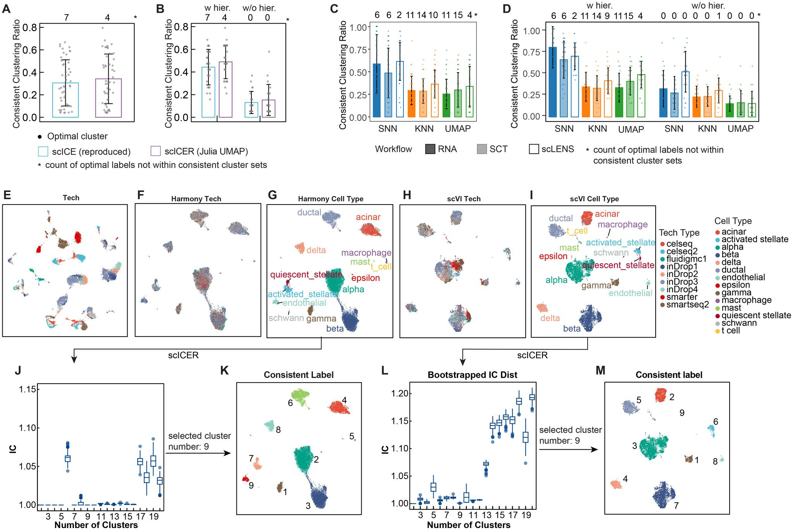

# scICER: Single-cell Inconsistency-based Clustering Evaluation in R

[](https://cran.r-project.org/)
[](https://satijalab.org/seurat/)
[](https://opensource.org/licenses/MIT)

## Overview

**scICER** is an R package for evaluating clustering stability in single-cell analyses. It implements scICE-style inconsistency analysis on graphs stored in [Seurat](https://satijalab.org/seurat/) objects, including graphs from integrated workflows. It builds on the original [scICE Julia package](https://github.com/Mathbiomed/scICE).

The AnnData/Python counterpart is [**scICEpy**](https://github.com/ATPs/scICEpy).

### Publication

The scICER paper is published in *Bioinformatics Advances*: [https://doi.org/10.1093/bioadv/vbag334](https://doi.org/10.1093/bioadv/vbag334). The [paper PDF](./publication/scICER-paper-Bioinformatics-Advances-2026.pdf), [supplementary figures](./publication/Supplementary%20Figures.pdf), and supplementary tables [S1](./publication/Supplementary%20Table%20S1.xlsx), [S2](./publication/Supplementary%20Table%20S2.xlsx), [S3](./publication/Supplementary%20Table%20S3.xlsx), and [S4](./publication/Supplementary%20Table%20S4.xlsx) are available in this repository. The code used to generate the paper's results is available at [scICER-workflow](https://github.com/ATPs/scICER-workflow).




**Figure 1 from the published paper.** Panels A–D summarize the 48-dataset
benchmark; E–I show human pancreas data before and after Harmony or scVI
integration; J–M show bootstrapped IC distributions and selected clustering
labels. For this validation, K = 9 was selected by the highest ECS to annotated
cell types among candidates meeting the IC threshold.
Reproduced from [Yu et al. (2026)](https://doi.org/10.1093/bioadv/vbag334)
under [CC BY 4.0](https://creativecommons.org/licenses/by/4.0/).

### Key Features

- 🔬 **Automated Cluster Evaluation**: Systematically tests multiple cluster numbers to find consistent results
- ⚡ **Element-Centric Similarity (ECS)**: Efficient algorithm for comparing clustering results
- 🧬 **Seurat Integration**: Seamless integration with Seurat objects and workflows  
- 🚀 **Parallel Processing**: Leverages multiple cores for faster computation
- 📊 **Comprehensive Visualization**: Built-in plotting functions for result interpretation
- 📈 **Robust Statistics**: Bootstrap-based confidence intervals and stability assessment
- 🎯 **Reproducible Analysis**: Optional seed parameter for deterministic results
- 🔍 **Smart Parameter Recommendations**: Automatically suggests optimal parameters based on dataset size
- ✅ **Preprocessing Validation**: Checks and guides users through proper Seurat preprocessing
- 📋 **Comprehensive Reporting**: Generates detailed analysis summaries with interpretation guidance

### Algorithm Overview

scICER evaluates clustering consistency by:

1. **Multiple Clustering**: Runs Leiden clustering multiple times with different parameters
2. **Binary Search**: Automatically finds resolution parameters for target cluster numbers  
3. **ECS Calculation**: Uses Element-Centric Similarity to efficiently compare clustering results
4. **Optimization**: Iteratively refines clustering to minimize inconsistency
5. **Bootstrap Validation**: Assesses stability through bootstrap sampling
6. **Threshold Application**: Identifies cluster numbers meeting consistency criteria
7. **Reproducibility Control**: Optional seed parameter for deterministic results

### Performance Considerations vs [scICE Julia package](https://github.com/Mathbiomed/scICE)
- **Speed**: R implementation typically runs slower than the native Julia version
- **Memory**: Requires more memory for equivalent analyses
- **Accuracy**: While highly consistent, results may differ slightly from the original scICE due to implementation differences in R vs Julia, random number generation variations, and floating-point precision handling.

*Note: These tradeoffs provide better integration with the Seurat ecosystem and R workflows*

## Dependencies

scICER requires the [ClustAssess](https://github.com/Core-Bioinformatics/ClustAssess) library for Element-Centric Similarity (ECS) calculations, which provides:

- **~150x faster performance** for similarity calculations
- **Professional, well-tested implementation** by Cambridge Core Bioinformatics
- **Identical results** to reference implementations

ClustAssess will be automatically installed when you install scICER.

## Installation

### Prerequisites

Ensure you have R ≥ 4.0.0 and the required dependencies:

```r
# Install required CRAN packages
install.packages(c(
  "Seurat", "SeuratObject", "igraph", "Matrix", 
  "parallel", "foreach", "doParallel", "dplyr", 
  "ggplot2", "devtools", "ClustAssess"
))

# Optional: Install leiden package for better performance
install.packages("leiden")
```

### Install scICER from GitHub

```r
# Install devtools if not already installed
if (!requireNamespace("devtools", quietly = TRUE))
    install.packages("devtools")

# Install scICER from GitHub
devtools::install_github("ATPs/scICER", upgrade = "never")#avoid upgrade packages and use existing ones
```

## Quick Start

### Basic Workflow

```r
# Load required packages
library(scICER)
library(Seurat)
library(ggplot2)

# Set up a parallel worker budget (optional, but recommended)
n_workers <- 4  # start conservatively and adjust based on your system

# Load your Seurat object
data(pbmc_small)  # Example dataset
seurat_obj <- pbmc_small

# Ensure preprocessing is complete
seurat_obj <- NormalizeData(seurat_obj)
seurat_obj <- FindVariableFeatures(seurat_obj)  
seurat_obj <- ScaleData(seurat_obj)
seurat_obj <- RunPCA(seurat_obj)
seurat_obj <- FindNeighbors(seurat_obj, dims = 1:20)

# Run scICER analysis with a reproducible seed
scice_results <- scICE_clustering(
  object = seurat_obj,
  cluster_range = 3:20,
  n_workers = n_workers,
  min_cluster_size = 2,
  remove_threshold = Inf,
  verbose = TRUE,
  seed = 123  # Set seed for reproducible results
)

# Visualize results
plot_ic(scice_results, threshold = 1.005)

# Extract consistent clustering labels
seurat_obj <- get_robust_labels(scice_results, return_seurat = TRUE, object = seurat_obj)

# Visualize with consistent clusters, cluster range from 3 to 15
xl.fig <- list()
for (n in 3:15) {
  if (paste0("clusters_", n) %in% colnames(seurat_obj@meta.data)){
    xl.fig[[paste0("clusters_", n)]] <- DimPlot(seurat_obj, group.by = paste0("clusters_", n), label = TRUE) + ggtitle(paste("Clusters:", n))
  }
}

cowplot::plot_grid(plotlist = xl.fig, ncol = 3)
```

### Documentation Notes

See the [quickstart vignette](./vignettes/scICER-quickstart.Rmd) for a tutorial
and [`design.md`](./design.md) for implementation details, parameter semantics,
output fields, and differences between `cluster_range` and manual `resolution`
mode, including why `resolution = old_results$gamma` does not replay a previous
`cluster_range` run exactly.

### Background Runs and Verbose Logs

`scICE_clustering(..., verbose = TRUE)` prints timestamped progress messages like
`[YYYY-MM-DD HH:MM:SS] ...` via `message()`, which goes to `stderr`.
If you launch jobs in the background and only capture `stdout`, logs can appear missing.

Use:

```bash
Rscript examples/run_scice.R --help
Rscript examples/run_scice.R --input_qs input.qs --output_qs augmented_with_scice.qs > scice.log 2>&1 &
tail -f scice.log
```

For very large input objects, `qs::qread()` can be silent for a while before scICER starts.
The provided `run_scice.R` script prints timestamped checkpoints before and after
each major step, builds a lightweight Seurat object that keeps two features
plus the requested graph for the clustering phase, deletes the original large
object before `scICE_clustering()`, then reloads the original object only for
metadata merge. The final augmented Seurat object is saved with `qs`.
The script accepts both environment variables and explicit CLI flags such as
`--qread_threads`, `--n_workers`, `--cluster_range`, and `--resolution`.
If `--output_qs` is omitted, it defaults to `--input_qs`.

### Worker and CPU Usage

`n_workers` is a scICER worker budget, not a strict upper bound on total CPU
cores or OS processes. In `cluster_range` mode, scICER can run outer workers for
different target cluster numbers and nested workers for gamma evaluation,
iterative refinement, or bootstrap steps. These nested `parallel::mclapply()`
calls can make the observed process count or CPU usage higher than `n_workers`.
Native libraries used by R packages, especially igraph/Leiden backends, may also
use OpenMP or BLAS threads unless they are limited by the environment.

Most users do not need to tune these settings for ordinary local runs. They
matter mainly on shared servers, scheduled jobs, or environments with strict CPU
limits.

Practical recommendations:

- Set `n_workers` below your scheduler CPU allocation when using broad
  `cluster_range` values or large `n_trials`/`n_bootstrap`.
- Limit native library threading before starting R, for example:

```bash
export OMP_NUM_THREADS=1
export OPENBLAS_NUM_THREADS=1
export MKL_NUM_THREADS=1
export BLIS_NUM_THREADS=1
Rscript examples/run_scice.R --input_qs input.qs --output_qs output.qs
```

- Remember that `qs::qread(..., nthread = ...)` or the script option
  `--qread_threads` is separate from `n_workers`.
- If your environment enforces a hard CPU cap, prefer a smaller `n_workers`,
  narrower `cluster_range`, and lower `n_trials`/`n_bootstrap`, then scale up
  after checking actual CPU and process counts.

## Detailed Usage

### 1. Advanced Parameter Customization

```r
# Fine-tuned parameters for large datasets
results <- scICE_clustering(
  object = large_seurat_object,
  graph_name = "RNA_snn",         # Optional: specify graph name
  cluster_range = 5:12,           # Focused range for efficiency
  objective_function = "CPM",     # "CPM" or "modularity"
  beta = 0.1,                     # Leiden beta parameter
  n_iterations = 10,              # Initial Leiden iterations
  max_iterations = 150,           # Maximum optimization iterations
  remove_threshold = 1.15,        # Filter inconsistent results
  min_cluster_size = 2,           # Default threshold; final merge only on best_labels
  resolution_tolerance = 1e-8,    # Resolution search precision
  n_trials = 10,                  # Reduced for speed
  n_bootstrap = 50,               # Reduced for speed
  seed = 12345                    # For reproducible results
)
```

It's OK to set a large `remove_threshold` value, because `plot_ic` and `get_robust_labels` all have default `threshold = 1.005`.
`min_cluster_size = 2` approximates Seurat singleton grouping; use `min_cluster_size = 1` to keep raw Leiden clusters.
`labels` stay raw for IC/MEI, while `best_labels` receives one final merge pass when `min_cluster_size > 1`.

### 2. Manual Resolution Mode

`resolution` can be a single gamma or a vector of gamma values. When `resolution` is provided, scICER skips the `cluster_range` resolution search, evaluates the supplied gamma values directly, and keeps the lowest-IC result for each final cluster number. If both `resolution` and `cluster_range` are provided, `resolution` takes priority and `cluster_range` is ignored with an informational message.

`resolution_diagnostics` retains one row per input gamma, including gamma values
that were not retained in the main result after deduplication by cluster number.

```r
# Evaluate several user-provided gamma values
results_manual <- scICE_clustering(
  object = your_seurat_object,
  resolution = c(0.1, 0.2, 0.4, 0.8),
  n_trials = 15,
  n_bootstrap = 100,
  min_cluster_size = 2,
  seed = 42
)

# Plot the retained results
plot_ic(results_manual, threshold = 1.005)

# Per-gamma diagnostics for all user-supplied resolutions
results_manual$resolution_diagnostics

# Lowest-IC returned solution
results_manual$best_cluster
results_manual$best_resolution
```

### 3. Visualization and Results

```r
# Plot Inconsistency Coefficient (IC) scores
plot_ic(results, 
        threshold = 1.005,
        title = "Clustering Consistency Analysis")

# Plot stability analysis
plot_stability(results)

# Extract summary of consistent clusters
summary <- extract_consistent_clusters(results, threshold = 1.005)
print(summary)

# Get clustering labels as data frame
labels_df <- get_robust_labels(results)

# Add results directly to Seurat object
seurat_obj <- get_robust_labels(results, return_seurat = TRUE, object = seurat_obj)
```

### 4. Continue with Seurat

After adding labels to `seurat_obj` in the basic workflow, select a returned
`clusters_<K>` column for visualization and marker analysis (8 is illustrative):

```r
# Continue with standard Seurat analysis
seurat_obj <- RunUMAP(seurat_obj, dims = 1:20)
DimPlot(seurat_obj, group.by = "clusters_8")  # Use consistent clustering

# Find markers for consistent clusters
Idents(seurat_obj) <- "clusters_8"
markers <- FindAllMarkers(seurat_obj)
```


## Understanding the Output

### Main Results Object

The `scICE_clustering()` function returns a list containing:

- `gamma`: Resolution parameters for each cluster number
- `labels`: Raw clustering arrays used for IC/MEI (no small-cluster merge)
- `ic`: Inconsistency scores (lower = more consistent)
- `ic_vec`: Bootstrap IC distributions
- `n_cluster`: Number of clusters tested
- `best_labels`: Final best labels (single post-optimization merge when `min_cluster_size > 1`)
- `consistent_clusters`: Cluster numbers meeting consistency threshold
- `mei`: Mutual Element-wise Information scores
- `analysis_mode`: `"cluster_range"` or `"resolution"`
- `resolution_input`: Manual gamma values requested by the user in `resolution` mode
- `resolution_diagnostics`: Per-gamma summary table in `resolution` mode
- `best_cluster`: Returned cluster number with the lowest IC score
- `best_resolution`: Gamma corresponding to `best_cluster`

`scICE_clustering()` returns a lightweight results object and does not store the full
Seurat input object. Pass the original Seurat object to
`get_robust_labels(..., return_seurat = TRUE, object = seurat_obj)` as shown above.

### Interpretation Guidelines

- **IC < 1.005**: Highly consistent clustering (recommended), less than 0.5% of cells is inconsistent.
- **IC 1.005-1.01**: Moderately consistent clustering, 0.5% to 1% of cells is inconsistent.
- **IC > 1.01**: Low consistency (not recommended), more than 1% of cells is inconsistent.

## Performance Tips

### For Large Datasets (>50k cells)

```r
# Get recommended parameters based on dataset size
recommended <- get_recommended_parameters(ncol(large_seurat_obj))

# Optimized settings for large datasets
results <- scICE_clustering(
  object = large_seurat_obj,
  cluster_range = 5:15,      # Focused range
  n_trials = 8,              # Fewer trials
  n_bootstrap = 50,          # Fewer bootstrap samples
  n_workers = detectCores() - 1,  # Worker budget; actual CPU use can be higher
  seed = 42                  # For reproducibility
)
```

### For Very Large Seurat Objects

For very large Seurat objects, the biggest avoidable memory cost is keeping the
full object in memory during the entire scICER run. `scICE_clustering()` only
needs the graph and cell names, so a practical pattern is:

1. read the original object with `qs::qread()`;
2. build a lightweight Seurat object that keeps two features plus the target graph;
3. remove the original object and run `gc()` before clustering;
4. run `scICE_clustering()` on the lightweight object;
5. reload the original object and add the chosen labels back with `get_robust_labels()`;
6. save both the results object and the augmented Seurat object with `qs::qsave()`.

```r
library(Seurat)
library(scICER)
library(qs)

input_qs <- "/path/to/very_large_object.qs"
graph_name <- "RNA_snn"
qread_threads <- 40

full_obj <- qs::qread(input_qs, nthread = qread_threads)

# Keep two features plus the graph so the clustering phase does not hold the
# full assay/reduction payload in memory. Some Seurat v5 Assay5 objects fail
# when DietSeurat() keeps only one feature.
assay_name <- DefaultAssay(full_obj)
keep_features <- head(rownames(full_obj[[assay_name]]), 2L)
if (length(keep_features) < 2L || anyNA(keep_features) || any(!nzchar(keep_features))) {
  stop("Need at least two valid feature names for the lightweight Seurat object.")
}
small_obj <- DietSeurat(
  object = full_obj,
  assays = assay_name,
  graphs = graph_name,
  dimreducs = NULL,
  features = keep_features,
  misc = FALSE
)

rm(full_obj)
gc()

results <- scICE_clustering(
  object = small_obj,
  graph_name = graph_name,
  cluster_range = 4:5,       # Keep the range focused for huge objects
  n_trials = 4,              # Start small and increase only if needed
  n_bootstrap = 20,
  n_workers = 40,
  remove_threshold = Inf,
  seed = 123,
  verbose = TRUE
)

rm(small_obj)
gc()

full_obj <- qs::qread(input_qs, nthread = qread_threads)
full_obj <- get_robust_labels(
  results,
  return_seurat = TRUE,
  object = full_obj,
  threshold = 1.01
)

qs::qsave(results, "scice_results.qs", preset = "balanced")
qs::qsave(full_obj, "very_large_object_with_scice.qs", preset = "balanced")
```

If this is still too slow, reduce `cluster_range` further or test a small set
of user-provided `resolution` values directly instead of scanning a wide target
cluster range. For the bundled background script, you can switch to manual
resolution mode without editing the file:

```bash
SCICE_RESOLUTION=0.01,0.02 \
SCICE_N_TRIALS=2 \
SCICE_N_BOOTSTRAP=10 \
Rscript examples/run_scice.R --input_qs input.qs --output_qs augmented_with_scice.qs
```

## Troubleshooting

### Common Issues

1. **"Graph not found" error**: 
   - Run `FindNeighbors()` on your Seurat object first
   - Use `check_seurat_ready()` to validate preprocessing
   - By default, scICER uses the SNN graph from the active assay (e.g., "RNA_snn")
   - You can check available graphs with `names(your_seurat_object@graphs)`
   - Specify a different graph with the `graph_name` parameter if needed

2. **No consistent clusters found**: 
   - Try adjusting `ic_threshold` (e.g., 1.01)
   - Expand `cluster_range`
   - Check preprocessing quality
   - Use `create_results_summary()` for detailed analysis

3. **Memory or runtime issues**:
   - Follow [Performance Tips](#performance-tips) for parameter recommendations and lightweight Seurat objects.
   - See [Worker and CPU Usage](#worker-and-cpu-usage) when choosing a worker budget.

4. **Reproducibility issues**:
   - Always set the `seed` parameter
   - Keep all other parameters constant, including `n_workers`
   - In `cluster_range` mode, `n_workers` affects the resolution-search probe grid and search path, so changing it can produce different results even with the same `seed`
   - Document parameter values used

## Citation

If you use scICER in your research, please cite:

Beirui Yu, Donggang Xu, Zhangrui Shi, Muyang Li, Yuli Zheng, Xiaolong Cao, scICER: clustering stability assessment for integrated single-cell analyses, *Bioinformatics Advances*, Volume 6, Issue 1, 2026, vbag334, [https://doi.org/10.1093/bioadv/vbag334](https://doi.org/10.1093/bioadv/vbag334).

## Q&A

### How does scICER select the final clustering solution?

For each candidate, scICER compares repeated Leiden partitions using ECS and
reports an IC score; lower IC means greater consistency across runs. It selects
the partition with the highest average similarity to the other trials as the
representative solution. The default consistency threshold is 1.005; stability
should be considered alongside biological evidence when choosing a cluster
number. See [Algorithm Overview](#algorithm-overview) for the workflow and
[Manual Resolution Mode](#2-manual-resolution-mode) for gamma handling.

### Will increasing n_trials or n_bootstrap improve results?

**n_trials**:
- Increasing `n_trials` (default: 15) can improve the robustness of results
- More trials = more chances to find truly stable clustering solutions
- For large datasets, you might want to reduce trials to improve speed
- Recommended ranges:
  - Small datasets (<10k cells): 15-20 trials
  - Medium datasets (10k-50k cells): 10-15 trials
  - Large datasets (>50k cells): 8-10 trials

**n_bootstrap**:
- Increasing `n_bootstrap` (default: 100) improves confidence in IC score estimates
- More bootstrap iterations = more accurate stability assessment
- The default 100 iterations is usually sufficient
- Consider increasing for:
  - Critical analyses requiring high confidence
  - Publications or benchmark studies
  - Unusual or complex datasets
- Recommended ranges:
  - Standard analysis: 100 iterations
  - High-confidence analysis: 200-500 iterations
  - Note: Higher values increase computation time

Remember: Quality preprocessing (normalization, feature selection, dimensionality reduction) often has more impact than increasing these parameters.

## Support and Contributing

- 📋 **Issues**: Report bugs or request features on [GitHub Issues](https://github.com/ATPs/scICER/issues)
- 📧 **Contact**: atps@outlook.com
- 🤝 **Contributing**: Pull requests welcome!

## License

This package is licensed under the MIT License. See [LICENSE](LICENSE) file for details.

## Acknowledgments

- Original [scICE Julia package](https://github.com/Mathbiomed/scICE) developers
- [Seurat](https://satijalab.org/seurat/) team for the excellent single-cell framework
- R community for the robust package ecosystem

## Related Resources

- 📘 [Internal design document](./design.md)
- 📚 [Seurat Documentation](https://satijalab.org/seurat/)
- 🔬 [Original scICE (Julia)](https://github.com/Mathbiomed/scICE)
- 📖 [Single-cell Analysis Best Practices](https://www.sc-best-practices.org/) 
